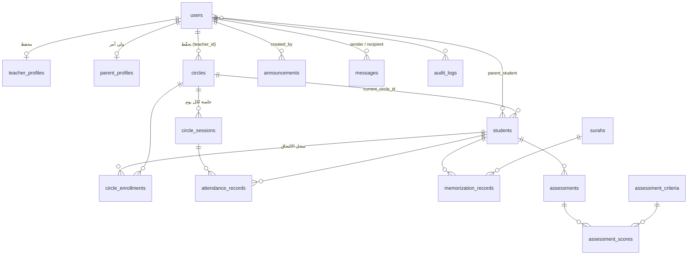

# تصميم قاعدة البيانات (ERD)

جميع الجداول تُنشأ عبر Laravel Migrations في `database/migrations`.

| الجدول | الغرض | ملاحظات |
|---|---|---|
| `users` | حسابات الدخول (مدير / محفظ / ولي أمر) | `role`، `status` (نشط/موقوف)، Soft Delete، غير قابلة للإسناد الجماعي |
| `teacher_profiles` / `parent_profiles` | بيانات إضافية للمحفظ وولي الأمر | علاقة واحد لواحد مع `users` |
| `students` | بيانات الطلاب (لا يملكون حسابات دخول) | `student_number` فريد، الحالة: نشط/موقوف/منسحب، Soft Delete |
| `parent_student` | ربط ولي الأمر بالأبناء (متعدد لمتعدد) | قيد فريد على (ولي الأمر، الطالب) + صلة القرابة |
| `circles` | الحلقات | رمز فريد، أيام الدراسة JSON، وقت البداية والنهاية، السعة، الحالة |
| `circle_enrollments` | سجل الالتحاق الحالي والتاريخي | `left_at` فارغ = العضوية الحالية؛ لا يُحذف عند النقل |
| `circle_sessions` | جلسة الحلقة في يوم محدد | قيد فريد (حلقة، تاريخ) يمنع تكرار الجلسة |
| `attendance_records` | الحضور والغياب | قيد فريد (جلسة، طالب) يمنع تكرار التحضير |
| `surahs` | السور الـ114 وعدد آياتها | تُستخدم للتحقق من نطاق الآيات |
| `memorization_records` | سجلات الحفظ الجديد والمراجعة والتثبيت | الدرجة من 100 + التقدير المشتق، الأخطاء، الملاحظات، التوصيات، المشاركة مع ولي الأمر |
| `assessment_criteria` | معايير التقييم القابلة للتعديل من الإدارة | |
| `assessments` + `assessment_scores` | التقييمات الدورية | تُحفظ الدرجة العظمى وقت التقييم حتى لا تتأثر بتعديل المعيار لاحقاً |
| `announcements` | الإعلانات | الفئة: الكل / المحفظون / أولياء الأمور / عام، تاريخ نشر وانتهاء |
| `notifications` | الإشعارات داخل الموقع | جدول Laravel القياسي (قابل للتوسع للبريد والرسائل) |
| `messages` | المراسلة بين ولي الأمر والمحفظ | |
| `contact_messages` | رسائل نموذج التواصل العام | |
| `settings` | إعدادات المركز | |
| `audit_logs` | سجل العمليات المهمة | القيم القديمة والجديدة (بدون كلمات المرور) |

## قواعد حماية البيانات التعليمية
- حذف الطالب أو المحفظ أو الحلقة **ناعم (Soft Delete)**، فتبقى السجلات التعليمية.
- نقل الطالب يتم عبر `EnrollmentService` داخل Transaction: يُغلق الالتحاق السابق ويُفتح جديد، ولا تُمس سجلات الحضور والحفظ والتقييم.
- تسجيل الحضور داخل Transaction ويُحدِّث السجل الموجود بدلاً من تكراره.
- الآيات لا تُعدّ محفوظة إلا بسجل «حفظ جديد» بدرجة ≥ درجة الاجتياز (قابلة للتعديل من الإعدادات).
